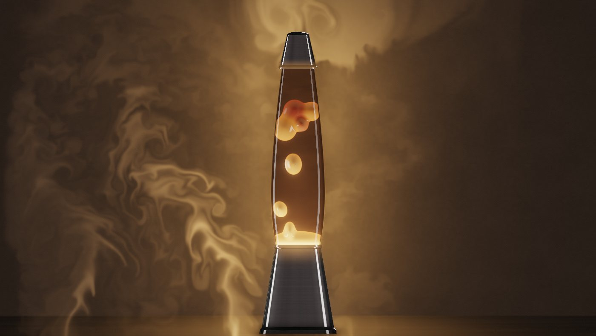

# Sentinel Lava Lamp

A glass lava lamp you can watch, stir, tune, and play music under. The wax runs on heat, the smoke behind it is a real fluid simulation, and the music can paint the whole room.

**Try it:** https://sentinel-lava-lamp.vercel.app



---

## How to use it

### Just watch

Open the page and the lamp is already warm. Wax pools at the bottom, domes up, pinches off a blob and sends it climbing. Blobs cool under the cap, drift back down and melt into the pool. Nothing repeats; every cycle comes out of the physics.

To see only the lamp, press **Hide menus** (top right). Press **Menus** (bottom right) to bring them back. The lamp remembers which you chose.

### Touch it

| Do this | What happens |
| --- | --- |
| Drag inside the glass | Nudges the nearest blob of wax. A quick flick can knock a forming blob loose. |
| Drag in the air around the lamp | Pushes and swirls the smoke. |
| Turn on **Drip**, then tap inside the glass | Drops a new warm blob of wax where you tapped. |

Works with a mouse, a finger, or several fingers at once.

### Play music

Open **Listen** (on a phone, tap **Listen** at the bottom).

1. Press **Upload audio** and choose an mp3, wav, m4a, ogg or flac file, or drag a file onto the Listen panel.
2. Use the play button, the scrub bar and **Volume** like any player.
3. Watch the lamp respond:
   - **Bass** heats the coil, so the wax works harder and pinches off blobs on the beat. The glow and the smoke swell with it.
   - **Kick drums** flash the light and push bursts of smoke up from the floor.
   - **Mids and highs** swing the room's light around the color wheel (warm lamps go through rose and magenta toward violet) and stir the air.
   - Each puff of smoke keeps the color of the moment it was released, so the rising smoke carries a trail of the song's colors.

You can also paste a **YouTube link** and press **Play**. It plays alongside the lamp, but browsers don't let a web page read YouTube's audio, so the lamp can't react to it. Upload a file for the full show.

### Tune it

Open **Tune** to change how the lamp behaves. The word on the right of each slider tells you roughly where you are.

| Control | What it changes | Low → high |
| --- | --- | --- |
| **Color swatches** | Wax and light color: Amber, Magma, Absinthe, Tide, Violet, Rose. | |
| **Coil** | How hot the bulb runs. More heat means more blobs, more often. | cool → hot |
| **Rise** | How eagerly warm wax climbs. | still → eager |
| **Thickness** | How viscous the liquid is. Thick liquid slows everything down. | thin → tar |
| **Swirl** | Strength of the slow currents in the liquid and the drafts in the room. | calm → wild |
| **Size** | How big the blobs are. | beads → globs |
| **Chill** | How fast the top of the bottle cools the wax. Low chill lets wax linger up top. | holds heat → quenches |
| **Glow** | Brightness of the bulb, the room light and the bloom. | dim → blaze |
| **Music drive** | How hard the music pushes the wax, the smoke and the beat flashes. | ignore → kick |
| **Music color** | How far the music may recolor the light and smoke. "Lamp only" keeps your palette. | lamp only → light show |

Buttons under the sliders:

- **Reheat** restarts the wax from a fresh, warm state.
- **Drip** toggles tap-to-drop wax (see above).
- **Pause** freezes the wax and the smoke. Press **Resume** to continue.

Your settings are saved in this browser, so the lamp comes back the way you left it.

### A few recipes

- **Classic '70s:** Amber, Coil warm, Rise steady, Thickness syrup, Size gobs, Glow lamp.
- **Night light:** Violet or Tide, Coil cool, Rise still, Glow dim, Music color lamp only.
- **Party:** any color, Coil hot, Rise eager, Swirl curling, Music drive kick, Music color light show, then upload something with a big low end.
- **Lava flow:** Magma, Thickness tar, Size globs, Chill holds heat. Big, slow, heavy wax.

### If something looks off

- **"WebGL2 is required."** The lamp draws everything on the graphics card. Use a current Chrome, Edge, Firefox or Safari, and make sure hardware acceleration is on.
- **It runs slowly on an older device.** The lamp lowers its own internal resolution after a moment to keep the motion smooth. It may look a little softer.
- **Music plays but the colors don't change.** Check that **Music color** isn't at "lamp only", and that you uploaded a file rather than using YouTube.
- **No sound.** Check **Volume**, your device volume, and on iPhone the silent switch.

---

## How it works

Everything runs in your browser on the GPU through WebGL2. There's no server work and no video: every frame is computed.

Each frame goes through five stages:

```
wax physics (JS) ─┐
                  ├─► 1. smoke solver ─► 2. room + smoke ─► 3. lamp ─► 4. bloom ─► 5. final
music analysis ───┘    (fluid grid)       (half res)        (HDR)     (¼, ⅛ res)   (tonemap)
```

### The wax: a heat engine, not an animation

The wax is a set of up to 16 blobs (`src/lib/lamp/gobs.ts`), each with a position, velocity, amount of wax, temperature, and a stretch and angle for its shape.

- **The coil** heats a pool of wax resting on the bottom of the glass. When the pool is warm enough it starts a **bud**: a new blob tethered just above it that draws wax out of the pool, stretching into a neck until it's full and the neck snaps.
- **Heat exchange.** Every blob trades heat with the liquid around it. The trade is strong near the coil, strong under the cold cap, and weak in the middle of the bottle, which is effectively insulated. That's what keeps a real lamp cycling instead of hovering. Small blobs gain and lose heat faster than big ones, as they would in reality (more surface for their volume).
- **Buoyancy and drag.** Warm wax is lighter than the liquid, cool wax heavier. Drag is Stokes-like, so terminal speed grows with blob size: big blobs rise faster than small ones, and everything slows down in thick liquid.
- **Convection.** The liquid carries slow currents, built as the curl of evolving 3D noise so they never loop, plus a gentle updraft up the middle and down the walls.
- **Shape.** Blobs stretch along their direction of motion and wobble on a damped spring when they break free, bump each other, or flatten against the top.
- **Contact.** Blobs push each other apart and squash on impact. Two slow blobs at similar temperatures sometimes merge, draining smoothly into each other. A big, fast, stretched blob occasionally tears in two.
- **Return.** Cooled wax sinks and drains back into the pool. The total amount of wax never changes.

On screen the blobs are drawn as metaballs with elliptical, rotated kernels, so neighbours melt into one another with smooth necks.

### The smoke: a real fluid simulation

The smoke (`src/lib/fluid/`) is a stable-fluids solver adapted from [Navier–Stokes Laboratory](https://github.com/jkh2/navier-stokes-laboratory), running on GPU textures that match the screen's shape. Each step:

1. **Inject:** five sources add density, heat and a color tag. Four wander along the floor and breathe out soft, bursty puffs; one is a thin warm plume off the lamp's cap.
2. **Forces:** hot smoke rises (buoyancy), dense smoke settles slightly, and a slow room draft (curl noise) pushes it around.
3. **Vorticity confinement** keeps the curls alive. It's kept low so the smoke billows rather than shredding into threads.
4. **Pressure projection** (20 Jacobi iterations) keeps the flow incompressible, which is what gives smoke its rolling, folding look.
5. **Advection** carries velocity, density, heat and color along the flow. Everything fades slowly.

The smoke is shaded with fake self-shadowing (a short march toward the glowing glass), plus a scattering term so thick smoke picks up the room's light instead of turning black.

### The lamp, glass and room

- **Shape:** a classic rocket silhouette shared by the renderer, the physics and touch input (`src/lib/lamp/geometry.ts`), so the wax, the glass and your finger all agree on where the walls are.
- **Glass:** treated as a liquid-filled cylinder, so the room behind it appears flipped and squeezed, with a hint of color fringing. Reflections of a real studio light probe give the long highlights down the sides, stronger toward the edges as real glass does. The glass edge is thicker and catches the bulb's light.
- **Wax shading:** translucent, lit from the bulb below. Thin edges glow, thick cores hold the light, glossy highlights come from the same studio probe, and a soft rim imitates light scattering inside the wax.
- **Metal:** graphite base and cap with brushed reflections and the lamp's warm spill on them.
- **Room:** the glowing glass acts as a line light. It lights the plaster wall and the smoke, and pools on a glossy table that reflects the lamp.
- **Finish:** HDR bloom, ACES tonemapping, a vignette, and blue-noise dithering and grain to keep dark gradients from banding.

### Music

`src/lib/audio/rig.ts` analyses the playing file with the Web Audio API and splits it into bass, mid and treble bands every frame.

- **Bass** adds coil heat, speeds up budding, and swells the glow and the smoke sources.
- **Bass onsets** (beats) give a short light flash and a smoke burst.
- **The balance of mids and highs against bass** sets a target hue offset. The light eases toward it so it flows instead of flickering, and brightness is held steady through the color change.
- **Treble** stirs the room's draft.
- Every smoke puff stores the hue it was born under (density × hue in the smoke texture's blue channel), so rising smoke keeps the song's color history.

### Keeping it smooth

- The canvas is capped at 2× device pixel ratio and about 2.6 megapixels.
- The room is drawn at half resolution and bloom at a quarter and an eighth.
- A governor watches frame times. If frames run long it lowers the internal render scale (down to 55%), and raises it again when there's headroom.
- The smoke is pre-run for a few seconds at startup so there's smoke on the first frame.
- On rare GPUs without float textures the smoke switches off and everything else still runs.

### Where things live

| Path | What's there |
| --- | --- |
| `src/components/lamp/experience.tsx` | The page: canvas, render loop, touch input, panels. |
| `src/components/lamp/listen-dock.tsx` | Listen panel: upload, YouTube, transport, volume. |
| `src/components/lamp/tune-panel.tsx` | Tune panel: colors, sliders, buttons. |
| `src/lib/fluid/engine.ts` | The WebGL engine: buffers, smoke solver steps, render passes, music color, quality governor. |
| `src/lib/fluid/shaders.ts` | All GLSL: solver, room, lamp, bloom, final. |
| `src/lib/lamp/gobs.ts` | Wax physics. |
| `src/lib/lamp/geometry.ts` | Lamp profile, layout and coordinate conversions. |
| `src/lib/lamp/palettes.ts` | The six color palettes. |
| `src/lib/lamp/settings.ts` | Default settings and saving them in the browser. |
| `src/lib/audio/rig.ts` | Audio playback and analysis, YouTube player. |
| `public/env-studio.jpg`, `public/blue-noise.png` | Reflection probe and dither texture. |

---

## Run it locally

```bash
npm install
npm run dev
```

Then open http://127.0.0.1:8080

Other scripts: `npm run build` (production build), `npm run typecheck`.

Pushes to `main` deploy to Vercel automatically.

## Credits

- Glass and metal reflections use [Monochrome Studio 02](https://polyhaven.com/a/monochrome_studio_02) by Poly Haven (CC0), via the three.js examples.
- Dithering and grain use a [blue-noise texture](https://github.com/Calinou/free-blue-noise-textures) by Christoph Peters (CC0).
- The smoke solver is adapted from [Navier–Stokes Laboratory](https://github.com/jkh2/navier-stokes-laboratory).
